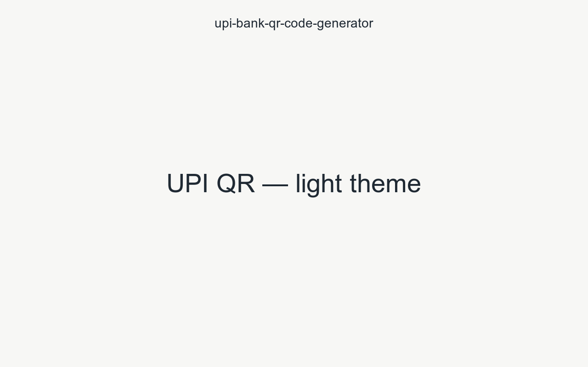
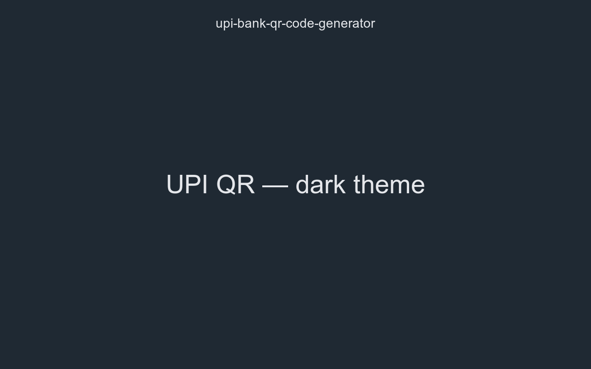

# 📱 UPI Bank QR Code Generator

> Generate, download, copy, and print UPI QR codes for your bank account —
> right from your browser. **100% offline, dependency-free, and privacy-first.**

[](LICENSE)
[](https://github.com/itisuniqueofficial-gh/bank-upi-qr-code-generator)
[](#)

---

## ✨ Features

- **UPI QR generation** — Generate scannable `upi://pay` QR codes for any
  bank account (account number + IFSC, VPA, or mobile + bank code).
- **Instant live preview** — The QR code updates as you type.
- **Multiple formats** — Export as **PNG**, **SVG**, or copy the raw QR text
  to the clipboard.
- **Flexible amount & note** — Add a fixed or optional amount and a payment
  note/reference to the QR payload.
- **Size presets** — Choose QR sizes for screens, labels, or print.
- **Print-friendly** — Print a clean, receipt-style QR code.
- **Dark & light themes** — Auto-follows your system or manual toggle.
- **Responsive & accessible** — Works on desktop, tablet, and mobile.
- **PWA-ready** — Installable and offline-capable (service worker).
- **Privacy-first** — All processing happens locally in your browser. Your
  bank details are never sent to any server.
- **Zero dependencies** — No frameworks, no trackers, no build step.

## 🚀 Live demo

🌐 **https://upiqr.example.com**

> The live site is hosted on **Cloudflare Pages**. Replace the placeholder
> with your production URL after deployment. For step-by-step deployment
> instructions (Wrangler CLI, dashboard, or Git integration), see
> [docs/DEPLOYMENT.md](docs/DEPLOYMENT.md).

## 🧰 Tech stack

| Area      | Choice                                           |
| --------- | ------------------------------------------------ |
| Language  | Vanilla JavaScript (ES modules)                  |
| Markup    | Semantic HTML5                                   |
| Styling   | Modern CSS with custom properties                |
| QR engine | Self-contained QR generation (no external CDN)   |
| Backend   | None — fully client-side                         |
| Hosting   | Cloudflare Pages (static)                        |
| CI/CD     | GitHub Actions (lint) · manual Cloudflare deploy |

## 📂 Project structure

```
├── index.html              # single-page application markup
├── css/                    # stylesheets
│   ├── reset.css           # reset & base styles
│   ├── variables.css       # design tokens (colors, spacing, radii)
│   ├── layout.css          # app shell & grid
│   ├── forms.css           # inputs, buttons, selects
│   ├── utilities.css       # helpers & print styles
│   ├── main.css            # app-specific styles
│   └── qr.css              # QR preview & card styles
├── js/                     # ES modules
│   ├── app.js              # application bootstrap & state
│   ├── config.js           # constants & presets
│   ├── validator.js        # account/IFSC/VPA/amount validation
│   ├── generator.js        # UPI payload builder
│   ├── qr.js               # QR matrix generation
│   ├── download.js         # PNG/SVG download helpers
│   ├── clipboard.js        # copy-to-clipboard helper
│   ├── storage.js          # localStorage persistence
│   ├── theme.js            # dark/light theming
│   └── utils.js            # small shared utilities
├── icons/                  # favicon & PWA icons
├── assets/                 # shared static assets
├── screenshots/            # README screenshots
├── docs/                   # project documentation
├── 404.html                # custom 404 page
├── robots.txt              # crawler rules
├── sitemap.xml             # sitemap
├── manifest.webmanifest    # PWA manifest
├── sw.js                   # service worker (offline caching)
└── .github/                # templates, workflows, governance files
```

## 📦 Getting started

### Prerequisites

- A modern browser (Chrome, Edge, Firefox, Safari).
- **No installation required.** Optionally, [Node.js](https://nodejs.org)
  20+ only if you want the dev validation scripts.

### Run locally

The app has no build step — serve the folder over HTTP:

```sh
# Option A — Python
python3 -m http.server 8080

# Option B — npx
npx serve .

# Option C — VS Code Live Server
```

Then open <http://localhost:8080>.

### Validate (optional)

```sh
npm install
npm run lint
```

## 🖼️ Screenshots

_Placeholder — replace with your own screenshots._

| Light theme                             | Dark theme                            |
| --------------------------------------- | ------------------------------------- |
|  |  |

## 🧮 How the UPI payload works

The app builds a standard UPI deep-link URI:

```text
upi://pay?pa=<VPA>&pn=<NAME>&am=<AMOUNT>&cu=INR&tn=<NOTE>&tr=<REFERENCE>
```

- `pa` — Payment address (VPA) or the account mapped address.
- `pn` — Payee name.
- `am` — Amount (optional).
- `cu` — Currency (INR).
- `tn` — Transaction note (optional).
- `tr` — Transaction reference (optional).

Most UPI apps (GPay, PhonePe, Paytm, BHIM, SBI YONO, etc.) can scan the
resulting QR and open a pre-filled payment screen.

## 🧩 How to contribute

We welcome contributions of all kinds. See the
[Contributing Guide](.github/CONTRIBUTING.md) and the
[Roadmap](ROADMAP.md) to get started.

1. 🍴 Fork the repository.
2. 🌿 Create a feature branch.
3. ✍️ Make your changes.
4. ✅ Run `npm run lint`.
5. 🔀 Open a pull request.

## 🗺️ Roadmap

See [ROADMAP.md](ROADMAP.md) for planned features and milestones.

## 📜 Changelog

See [CHANGELOG.md](CHANGELOG.md) for the full version history.

## 🔒 Security

If you find a security vulnerability, **do not** open a public issue.
Please follow the disclosure instructions in [SECURITY.md](.github/SECURITY.md).

## 📄 License

This project is licensed under the [MIT License](LICENSE).

---

<p align="center">
  Built with ❤️ for the UPI ecosystem &nbsp;·&nbsp; <a href="https://www.npci.org.in/what-we-do/upi/">Learn more about UPI</a>
</p>
